<a href="https://myothant.dev">
<picture>
  <source media="(prefers-color-scheme: dark) and (max-width: 640px)" srcset="assets/hero-m-dark.svg">
  <source media="(max-width: 640px)" srcset="assets/hero-m-light.svg">
  <source media="(prefers-color-scheme: dark)" srcset="assets/hero-dark.svg">
  
</picture>
</a>

<picture>
  <source media="(prefers-color-scheme: dark) and (max-width: 640px)" srcset="https://readme-typing-svg.demolab.com?font=Fira+Code&weight=500&size=24&duration=2600&pause=1000&color=E5B84B&center=true&vCenter=true&width=620&lines=%3E+designing+AI+agents+that+think%2C+plan+and+act;%3E+orchestrating+LLMs+into+real+products;%3E+building+multi-agent+systems;%3E+welcome%2C+operator.">
  <source media="(max-width: 640px)" srcset="https://readme-typing-svg.demolab.com?font=Fira+Code&weight=500&size=24&duration=2600&pause=1000&color=8A6A2A&center=true&vCenter=true&width=620&lines=%3E+designing+AI+agents+that+think%2C+plan+and+act;%3E+orchestrating+LLMs+into+real+products;%3E+building+multi-agent+systems;%3E+welcome%2C+operator.">
  <source media="(prefers-color-scheme: dark)" srcset="https://readme-typing-svg.demolab.com?font=Fira+Code&weight=500&size=18&duration=2600&pause=1000&color=E5B84B&center=true&vCenter=true&width=720&lines=%3E+designing+AI+agents+that+think%2C+plan+and+act;%3E+orchestrating+LLMs+into+real+products;%3E+building+multi-agent+systems;%3E+welcome%2C+operator.">
  
</picture>

  
  

<picture>
  <source media="(prefers-color-scheme: dark)" srcset="assets/divider-dark.svg">
  
</picture>

<picture>
  <source media="(prefers-color-scheme: dark) and (max-width: 640px)" srcset="assets/about-m-dark.svg">
  <source media="(max-width: 640px)" srcset="assets/about-m-light.svg">
  <source media="(prefers-color-scheme: dark)" srcset="assets/about-dark.svg">
  
</picture>

<picture>
  <source media="(prefers-color-scheme: dark)" srcset="assets/divider-dark.svg">
  
</picture>

<picture>
  <source media="(prefers-color-scheme: dark) and (max-width: 640px)" srcset="assets/code-m-dark.svg">
  <source media="(max-width: 640px)" srcset="assets/code-m-light.svg">
  <source media="(prefers-color-scheme: dark)" srcset="assets/code-dark.svg">
  
</picture>

<picture>
  <source media="(prefers-color-scheme: dark)" srcset="assets/divider-dark.svg">
  
</picture>

<picture>
  <source media="(prefers-color-scheme: dark) and (max-width: 640px)" srcset="assets/stack-m-dark.svg">
  <source media="(max-width: 640px)" srcset="assets/stack-m-light.svg">
  <source media="(prefers-color-scheme: dark)" srcset="assets/stack-dark.svg">
  
</picture>

<picture>
  <source media="(prefers-color-scheme: dark)" srcset="assets/divider-dark.svg">
  
</picture>

<picture>
  <source media="(prefers-color-scheme: dark)" srcset="https://streak-stats.demolab.com?user=johnathanMT&background=07070A&border=2E2A22&stroke=2E2A22&ring=E5B84B&fire=F5D061&currStreakNum=FAF7F0&sideNums=FAF7F0&currStreakLabel=E5B84B&sideLabels=B8B0A0&dates=8F7A4A">
  
</picture>

 

© MTN.Digitosphere · Engineering intelligent systems with precision.

